<p align="center">
  <a href="https://nittanyrooms.vercel.app">
    <picture>
      <source media="(prefers-color-scheme: dark)" srcset="nittany-rooms-design/logo/readme-header-dark.png">
      
    </picture>
  </a>
</p>

A visual study-room finder for **Penn State University Park**. Pick a building on a 3D campus map, see which rooms are open right now and for how long, and continue to the **official Penn State reservation page** for that exact room.

**Live:** https://nittanyrooms.vercel.app

> **Student-made. Not an official Penn State service.** Nittany Rooms does not make reservations. Penn State's own systems decide who can book and confirm every booking.

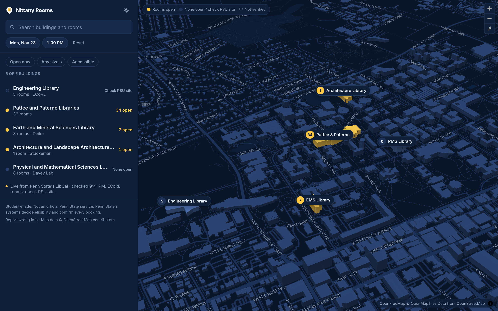

## What it does

### Live availability on a 3D campus map

Buildings with reservable rooms are drawn from their OpenStreetMap outlines and colored by what's free at the selected time: **green** = rooms open, **red** = none open, **grey** = closed or can't be checked, **purple** = walk-in study space. The list groups Libraries, Engineering, and open study spaces, with one badge per building (`22/36`, `0/8`, `Closed`, `Check site`).

Library availability is live from Penn State's public LibCal, refreshed every 3 minutes.

### From building to room to booking

| Building | Room |
|---|---|
| 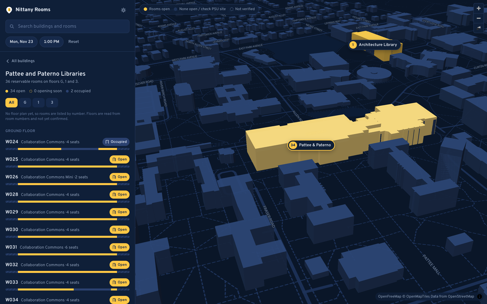 | 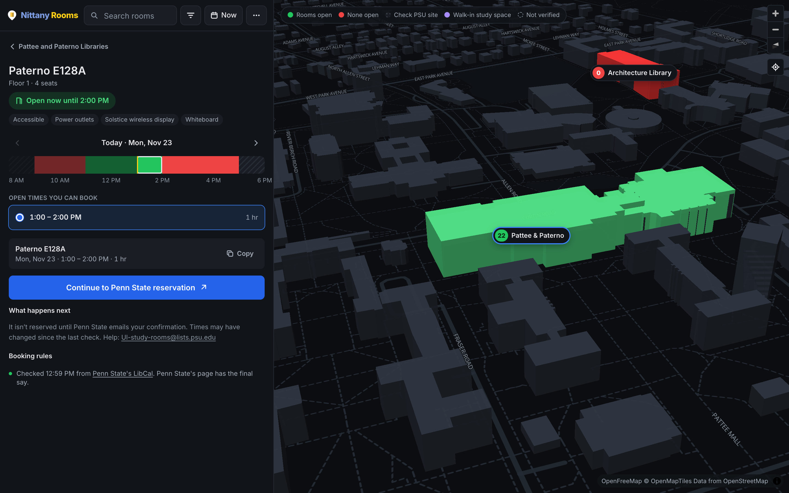 |

Choosing a building flies the camera in and lists its rooms by floor, each with a status chip and a mini day timeline. A room shows its features and capacity, a timeline for the day, the windows you can actually book (gaps too short to book are hidden), and **Continue to Penn State reservation**. That button goes straight to the room's LibCal page, or to Outlook with step-by-step instructions for College of Engineering rooms.

### Closest room and a walking route

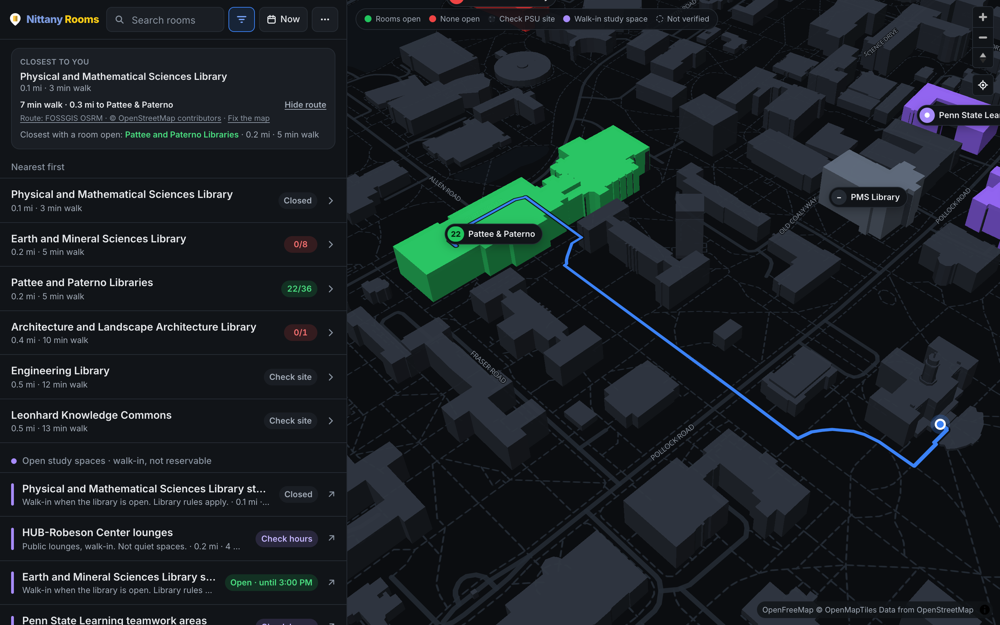

**Near me** sorts buildings by walking distance and shows the closest one, plus the closest with a room open now. **Show walking route** draws an animated path from your location. It asks before sending your location to the OpenStreetMap routing service (FOSSGIS OSRM).

### Filters, time travel, and settings

| Filters | Date and time | Settings |
|---|---|---|
| 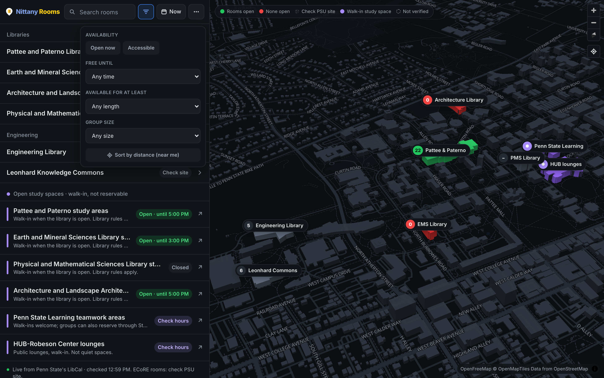 | 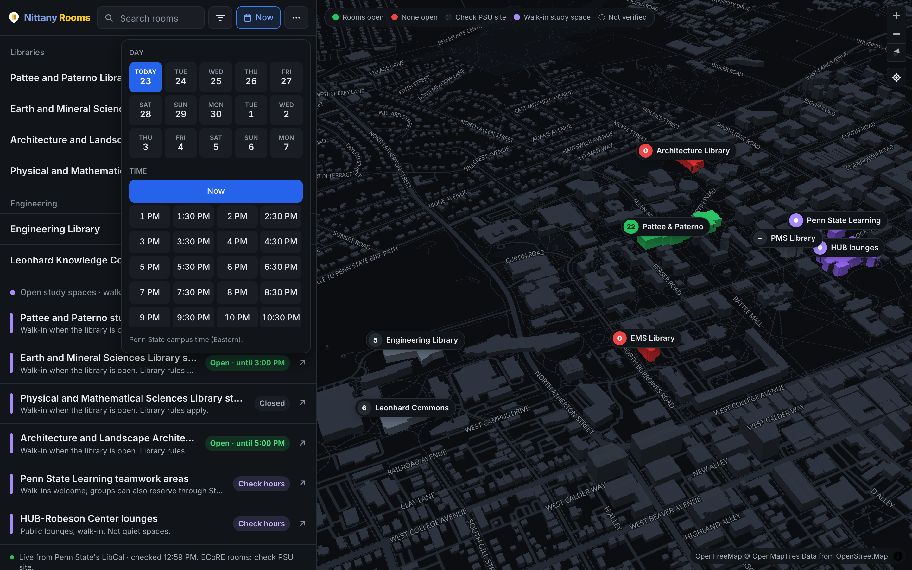 | 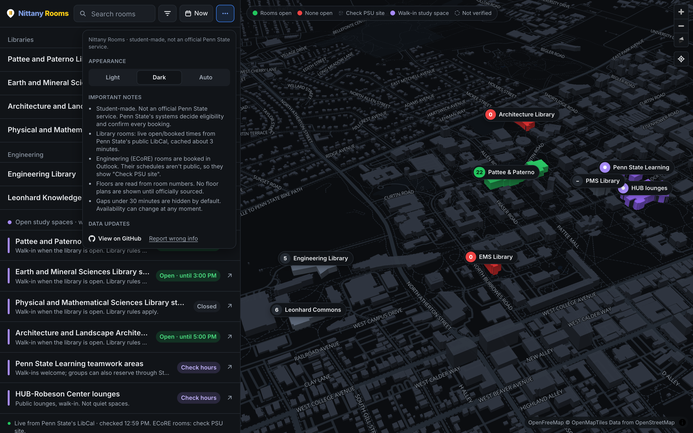 |

- **Filters:** Open now, Accessible, **Free until**, **Available for at least**, group size, sort by distance.
- **Date and time:** check any time in Penn State's two-week booking window.
- **Settings (⋯):** Appearance (Light / Dark / Auto), Important notes on how data is sourced, Data updates, View on GitHub.

### Open study spaces

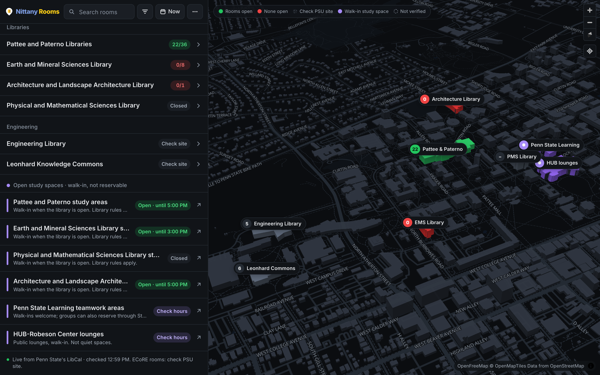

Walk-in spaces that don't need a reservation. Library study areas show live open or closed status. Spaces without published weekly hours, like the HUB lounges and Penn State Learning, say **Check hours** and link to the official page.

### Light mode and phones

| Light | Phone | Phone room |
|---|---|---|
| 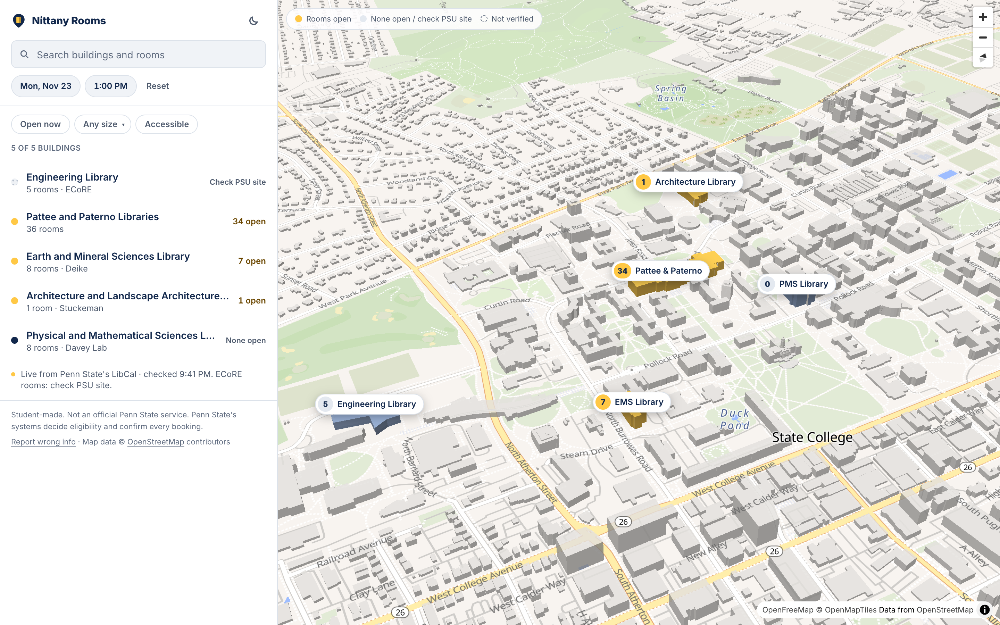 | 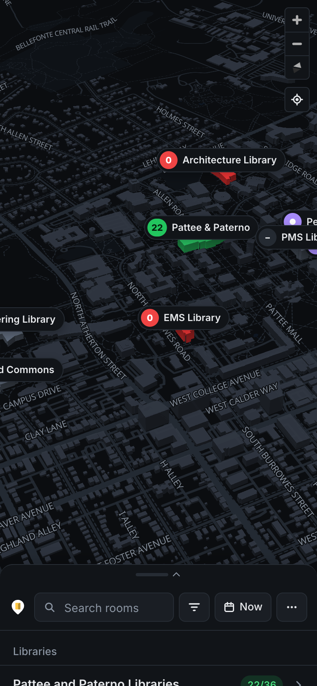 | 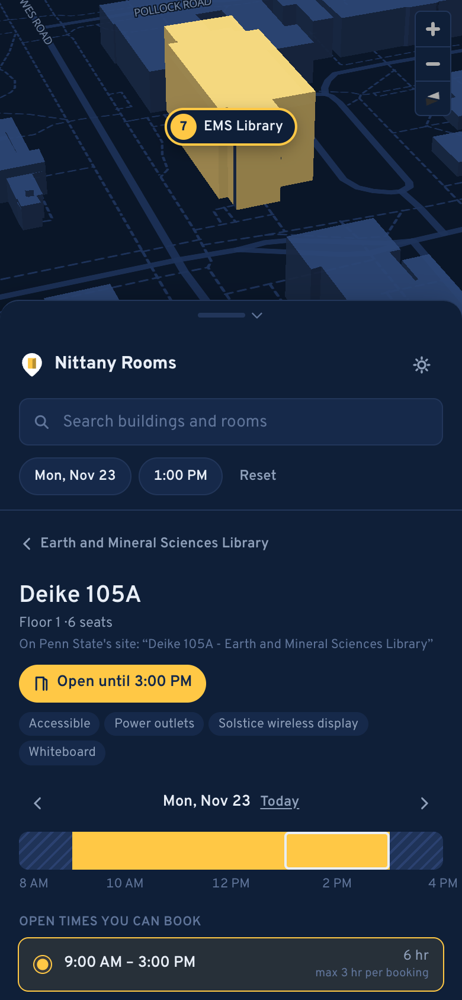 |

> Screenshots use **sample availability** (Mon Nov 23, 1:00 PM) so every state is visible; the live site shows real data.

## Coverage

| Where | Rooms | Booking | Availability |
|---|---|---|---|
| Pattee and Paterno, EMS (Deike), PMS (Davey), Architecture (Stuckeman) libraries | 53 | LibCal, direct room links | Live |
| Engineering Library (ECoRE) | 5 | Outlook (College of Engineering) | Check on PSU site |
| Leonhard Knowledge Commons | 6 (105A–F) | Outlook (College of Engineering) | Check on PSU site |
| Open study spaces | 6 | Walk-in | Library hours live; others "Check hours" |

Campus-wide classroom availability (classes, events, and building hours, like illiniSpots) is waiting on Penn State's permission. See [docs/research/SOURCE_INVENTORY.md](docs/research/SOURCE_INVENTORY.md) §9.

## Repository layout

| Path | Purpose |
|---|---|
| `apps/web/` | React + TypeScript + Vite app: 3D map (MapLibre + OpenFreeMap), sidebar, room timeline, booking handoff |
| `apps/web/api/` | Vercel Function `GET /api/availability?date=` (live LibCal availability, CDN-cached) |
| `apps/web/e2e/` | Playwright end-to-end tests (mocked API, keyboard, mobile, axe accessibility) |
| `packages/core/` | Shared schemas, the availability engine (pure functions), data-quality checks, LibCal ingestion |
| `data/` | Buildings, rooms, providers, policies, open spaces, and footprints, each with sources and verification dates |
| `docs/` | Plan, architecture, research, source inventory, known limitations |
| `nittany-rooms-design/` | Design system v2.1: tokens, design sheet, screenshots, logo, Inter font |

## Getting started

Requires Node 22+ and pnpm 10.

```sh
pnpm install
pnpm validate:data   # data-quality gate
pnpm test            # unit tests
pnpm e2e             # build + Playwright end-to-end tests
pnpm dev             # web app (also serves /api locally)
```

Server env vars (Vercel; see `apps/web/.env.example`): `LIBCAL_LIVE=off` disables live library availability, and `LIBCAL_USER_AGENT` sets the identifier sent to LibCal.

CI (GitHub Actions) runs the data gate, typecheck, unit tests, build, and end-to-end tests on every push. Vercel deploys `main` automatically (Root Directory: `apps/web`).

## Data rules

- Never invent buildings, rooms, coordinates, floor layouts, booking URLs, hours, or availability.
- Every record carries its source, its verification date, and a confidence status.
- If availability can't be verified, it's shown as **"Check PSU site"** (or "Check hours"), never as free.
- Penn State's booking page always has the final say.

## Credits

Map data © [OpenStreetMap](https://www.openstreetmap.org/copyright) contributors (ODbL), tiles by [OpenFreeMap](https://openfreemap.org), and walking routes by [FOSSGIS OSRM](https://routing.openstreetmap.de/about.html). The illiniSpots architecture (UIUC) inspired the approach. No code was copied.

## License

MIT. See [LICENSE](LICENSE).
