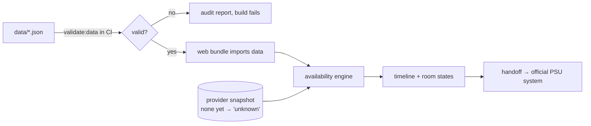

# Architecture

## Starting point

The repo started empty (MIT LICENSE only), so there was no existing stack to keep. The stack below was chosen for a TypeScript-first app that a student can run for free.

## Stack decisions

| Concern | Choice | Why | Revisit when |
|---|---|---|---|
| Monorepo | pnpm workspaces | Shared types between web, data validation, and (later) API | — |
| Front end | React 19 + TypeScript + Vite | Fast dev loop, static deploy, no server needed for MVP | SSR/SEO matters |
| Styling | Tailwind CSS v4 with design tokens from `nittany-rooms-design/tokens/tokens.json` | Tokens map 1:1 to CSS variables | — |
| Map | MapLibre GL JS + OpenFreeMap vector tiles (OSM data) | Open source, no API key or token, no usage billing, custom styling. Mapbox and Google need tokens and billing. | Tile host reliability or volume becomes a concern. Then self-host PMTiles. |
| Time math | Luxon | Solid IANA timezone and DST handling for `America/New_York` | `Temporal` ships in all target browsers |
| Validation | Zod | One schema for data files, the API contract, and runtime checks | — |
| Tests | Vitest (unit), Playwright (E2E, next milestone) | — | — |
| Data store (MVP) | Versioned JSON in `data/`, validated in CI | No live provider exists yet, so a DB adds ops cost with no benefit | First live adapter lands |
| Data store (later) | PostgreSQL, schema below | Snapshots, ingestion runs, audit log | — |
| Hosting | **Vercel (free Hobby plan)** | Project owner's choice. Static Vite build plus serverless functions, preview deploys per branch. | Traffic outgrows Hobby limits or the use becomes commercial (Hobby is for non-commercial use) |
| API (later) | Hono as **Vercel Functions** (`apps/web/api/`) | Provider credentials must stay server-side. Hono has a first-class Vercel adapter. | First credentialed adapter |

### Map provider comparison

| Provider | Cost | Token | Licensing | Notes |
|---|---|---|---|---|
| **MapLibre + OpenFreeMap** | Free | None | OSM ODbL, attribution | Chosen. Vector styling fits the design's navy/paper look. |
| MapLibre + tile.openstreetmap.org | Free (light use only) | None | OSM ODbL | Usage policy forbids heavy app traffic. Raster only. |
| Mapbox GL | Free tier, then metered | Public token | Proprietary SDK license | Good, but needs billing setup |
| Google Maps JS | Metered | API key | Restrictive styling and caching terms | Overkill |
| Official PSU map | — | — | Terms unknown | No public tile or API source found |

## Logical layout

```
apps/web/            React app: map, building view, floor schematic, room timeline, handoff
packages/core/       Shared, framework-free
  src/schema.ts        Zod schemas + TS types for buildings, floors, rooms, providers, sources
  src/availability/    Pure interval engine (half-open [start,end), America/New_York)
  src/validate/        Data-quality checks → audit report
  src/handoff.ts       Builds the official booking destination per provider
data/                Building, room, provider, and source records (with provenance)
docs/                Plan, architecture, research
```

Later additions: `apps/api/` (Hono), `packages/source-adapters/` (LibCal adapter, gated on permission), `database/migrations/`.

## Data flow (MVP)



## Availability engine contract

Inputs: room policy, operating window(s) for the date, busy intervals, a provider **snapshot** (`coverage`, `complete`, `retrievedAt`), the current time, and the freshness threshold.

The engine produces segments typed as `occupied | closed | unavailable | free | unknown`, plus bookable windows, each with a list of valid start times and the reason any gap was filtered out.

Rules:
1. Time is `free` **only** when the snapshot is `complete`, covers that time, and isn't stale. Otherwise it's `unknown`.
2. Intervals are half-open `[start, end)` in epoch ms. Display uses `America/New_York`.
3. A gap must be at least `max(minUsefulMinutes, policy.minDurationMinutes)` after applying lead time and rounding the start to the next increment.
4. Past time is clipped. Windows are capped at `maxDurationMinutes` for the bookable range.
5. The useful-gap threshold defaults to 30 minutes and can be set per room or provider in data, not in UI code.

## Target database schema (for when live data arrives)

`buildings`, `floors`, `rooms`, `room_features`, `reservation_providers`, `reservation_policies`, `availability_snapshots` (room_id, date, coverage_start/end, complete, retrieved_at, error), `availability_intervals` (snapshot_id, kind, start_utc, end_utc), `data_sources`, `data_ingestion_runs`, `floorplan_assets`, `room_floorplan_geometry`, `source_audit_log`. The JSON in `data/` already uses these entity shapes and IDs, so migrating is a load step.

## Hosting on Vercel

- **Project root:** `apps/web` (Vercel detects Vite). Build: `pnpm build`, output `dist/`. `apps/web/vercel.json` rewrites non-asset routes to `index.html` so deep links like `/b/ecore` work.
- **Monorepo:** Vercel installs from the workspace root with pnpm, so `@nittany-rooms/core` resolves as a workspace package. Data validation runs in `prebuild`, which means invalid data fails the deploy.
- **Secrets:** provider credentials go in Vercel project env vars (never `VITE_*`, which get bundled into client code).
- **Availability refresh (later):** Hobby cron jobs run at most once a day, too slow for availability. Instead, `GET /api/rooms/:id/availability` fetches from the provider on demand and returns `Cache-Control: s-maxage=<N>, stale-while-revalidate`. The CDN coalesces traffic, so the provider sees at most about 1 request per room per N seconds. The daily cron is reserved for slow-changing inventory checks.
- **Database (later):** a free Postgres from the Vercel Marketplace (Neon or Supabase), only if snapshots need to persist beyond the CDN cache.
- **Map tiles** come from OpenFreeMap directly in the browser, so Vercel serves no tile traffic.

## Security & privacy

- No accounts, no PSU credentials, no cookies from PSU. Discovery is anonymous and read-only.
- Availability only ever shows occupied/free, never who booked or why.
- Provider credentials (when granted) live only in server env vars. Never in the bundle.
