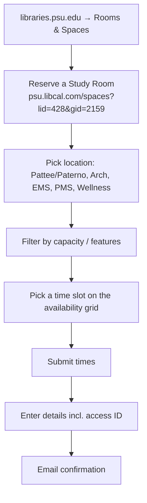
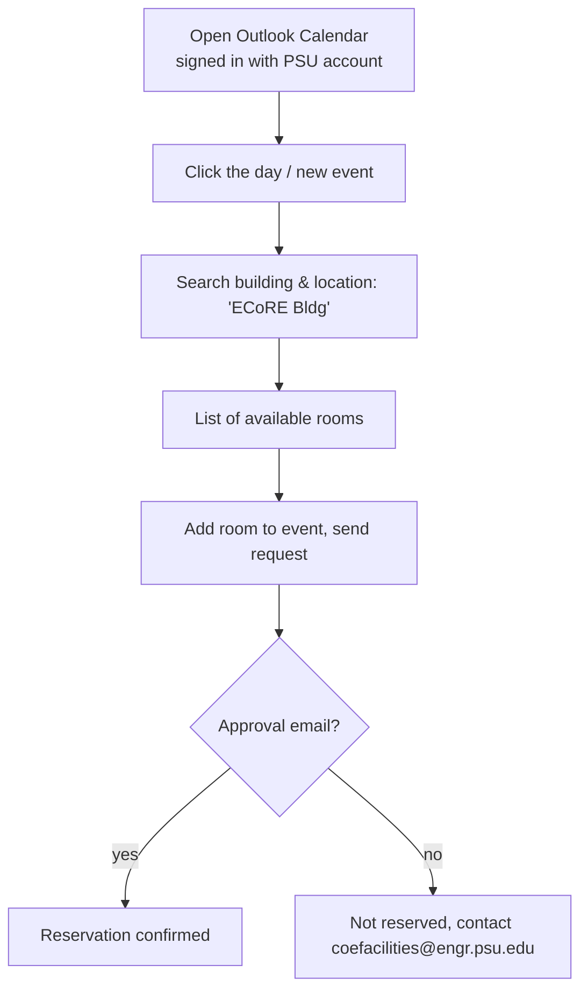
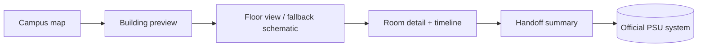

# Official booking flows (as a student sees them)

Researched 2026-11-22. See [SOURCE_INVENTORY.md](SOURCE_INVENTORY.md) for sources.

## A. Library group study room (LibCal)

**How Nittany Rooms hands off:** once room IDs are verified, link to that room's LibCal page. Until then, link to the University Park study-space page and show the room name and time so the student can find it there.

## B. ECoRE group study room (College of Engineering, Outlook)

**How Nittany Rooms hands off:** open Outlook on the web, then show the room number, date, and time along with these exact steps. Copy-to-clipboard for room and time. Never imply the booking is confirmed. Approval happens by email from Penn State.

## C. Nittany Rooms discovery flow

